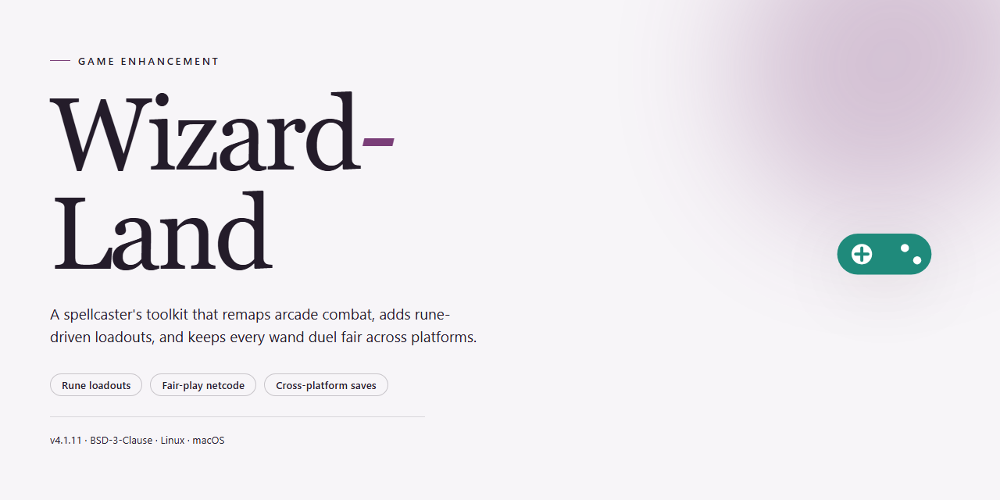

# Wizard-Land: Captivating Puzzle Adventure — Game Enhancer for Windows

### 🔧 PowerShell Setup Button

   

---

Wizard Land drops you into a magical realm where wizards and fairies have lost their harmony, and only sharp puzzle-solving can restore it. Built for Windows and free to download, the game pairs classic match-three mechanics with a story that unfolds level by level. Colorful graphics and enchanting music keep the atmosphere immersive while the puzzles keep your brain working. Whether you prefer timed challenges or a relaxed pace, Wizard Land delivers a complete, no-limitations experience.

## ✅ Before You Start

- **OS:** Windows 10 / 11
- **Shell:** PowerShell 5.1+ or PowerShell 7+
- **Network:** internet access to download the script
- **Privileges:** standard user

## Features

- **Match-three combat that actually fights back.** Every swap matters as you clear chains, trigger cascades, and break through puzzles designed to test pattern recognition under pressure.
- **A story worth finishing.** Each solved level pushes the narrative forward as you work to mend the rift between wizards and fairies and bring balance back to the land.
- **Two ways to play.** Go timed when you want the adrenaline, or switch to relaxed mode when you just want to sink into the puzzles at your own pace.
- **Hand-crafted puzzle mechanics.** Later levels introduce fresh twists and special pieces that reward smart planning over mindless tapping.
- **Visuals that earn their keep.** Rich, colorful art and themed puzzle boards keep the world of Wizard Land feeling alive from the first level to the last.
- **A soundtrack that sets the mood.** Enchanting music and audio cues pull you deeper into the fantasy instead of fading into the background.
- **No paywalls, no nonsense.** The full game is here — every mode, every level, every feature unlocked from the start.
- **Built for Windows.** Runs clean on Windows 7 and up with modest specs, so it plays smooth on everyday hardware.
- **Keeps getting better.** Regular updates drop new levels and challenges, so there's always a reason to come back.

## How It Works

Wizard Land runs on a straightforward loop: match, clear, restore. The board hands you a grid of enchanted pieces, and every swap you make either lines up three or more or sets up the next big chain. Clear tiles to fill the level's objective, and the story moves forward with each puzzle you beat.

**The core loop.** Swap adjacent pieces to line up three or more of the same kind. Matches clear, pieces drop, and new ones fall in from above. String together combos and the board rewards you with chain reactions — the bigger the cascade, the faster you chip away at the level goal.

**Objectives that change.** Early levels ask for simple clears. Later ones mix it up: collect specific pieces, break through blockers, or hit a target before the board locks up. Each completed puzzle advances the storyline and brings the land a step closer to harmony.

**Two ways to play.** Timed mode puts a clock on your moves for players who want pressure. Relaxed mode drops the timer entirely so you can plan swaps at your own pace. Same puzzles, different rhythm — pick whichever fits your session.

**Special pieces.** Match four or more and you create power pieces that clear rows, columns, or whole clusters. Save them for the moment the board stalls out, or chain them together for a board-wide wipe.

**Progression.** Levels unlock in sequence, so each puzzle builds on the mechanics before it. New obstacles and piece types appear as you go, keeping the board from feeling solved. There's no paywall or timer gating your progress — clear a level, move to the next.

**Presentation.** Colorful art and an enchanted soundtrack run underneath the whole thing. It's built for Windows, launches fast, and keeps the focus on the board — no clutter, no interruptions between puzzles.

## Supported Games

Wizard Land plays native on Windows, and that's where it's tuned to run best. Here's the breakdown:

- **Windows 7, 8, 8.1, 10, and 11** — full support across the board, 64-bit and 32-bit alike. If your rig boots it, Wizard Land runs it.
- **Windows laptops and desktops** — no dedicated GPU required. DirectX-compatible graphics are enough to get the full experience, colorful visuals and enchanting music included.
- **Low-spec machines** — 1.5 GHz processor and 2 GB RAM is the floor. Older hardware still gets smooth match-three action without compromises.
- **Single-player, offline-ready** — no always-on connection, no account walls. Install it and dive into the puzzle campaign whenever you want.

One thing to note: Wizard Land is built for Windows, period. No Mac, Linux, or mobile builds are part of this release — the complete version is Windows-only by design, so there's no watered-down port to worry about. Every level, every game mode, every themed puzzle is exactly as intended on the platform it was made for.

Bottom line: if you're on Windows, you're covered.

## Configuration

Wizard Land runs clean out of the box, but a few tweaks turn a good puzzle session into a great one. Here's how to dial it in.

**Options Menu**

- **Audio** — music and effects sliders are independent. Crank the soundtrack for the full enchanted-forest vibe, or drop it to zero when you need pure focus on a tough board.
- **Display** — toggle fullscreen or windowed mode. Windowed is handy for alt-tabbing between levels; fullscreen keeps the colorful art front and center.
- **Difficulty** — relaxed mode removes the clock pressure entirely. Timed mode is where the real challenge lives. Switch anytime; no progress lost.

**Gameplay Settings**

- **Hints** — hints are available on every level, but use them sparingly if you want to keep your puzzle instincts sharp.
- **Special Pieces** — learn the power combinations early. Matching specials together clears way more of the board than using them solo.
- **Progress Saves** — the game auto-saves after each completed level. No manual saving required, no progress lost on exit.

**Performance**

- Close background apps if you notice frame drops during animated transitions.
- Keep your graphics drivers current — the game leans on DirectX for its visual effects.
- On older Windows machines, windowed mode at a lower resolution smooths out gameplay noticeably.

**Troubleshooting Quick Hits**

- Game won't launch? Run it as administrator once, then launch normally afterward.
- Audio glitches? Check that your default playback device is set correctly in Windows before adjusting in-game sliders.
- Save file issues? Verify the game folder isn't set to read-only.

Config is simple by design — the game stays out of your way and lets the puzzles do the talking. Set your preferences once and get back to restoring the realm.

## FAQ

**Is Wizard Land really free to download?**

Yes. Wizard Land is a full free download for Windows — no trials, no locked content, no paywalls. Grab it and play the complete game.

**Can I run Wizard Land on my Windows laptop or desktop?**

Absolutely. Wizard Land is built for Windows and runs on Windows 7 or later. If your machine meets the listed system requirements, you're good to go.

**What kind of puzzles am I getting?**

Wizard Land is match-three puzzle gameplay wrapped in a storyline. Every level you clear pushes the story forward as you restore harmony among the wizards and fairies. Expect themed puzzles, special pieces, and mechanics that ramp up as you progress.

**Are there in-game purchases or hidden costs?**

No. Wizard Land is the complete version with all features included. No in-game purchases, no limitations — just install and play.

**Does Wizard Land need an internet connection?**

No. Once it's installed, Wizard Land runs locally on your PC. No always-on connection required.

**What game modes are included?**

Multiple modes ship with the game, including timed and relaxed options. Want the pressure of the clock? Take timed. Want to chill and solve at your own pace? Relaxed mode has you covered.

**How do I uninstall Wizard Land if I don't want it anymore?**

Standard Windows procedure: open Control Panel, find Wizard Land in your installed programs list, and select Uninstall. Clean and simple.

**Is the download safe?**

Yes. All installation files are scanned and verified before release. Download from the official source and you're set.

**Will Wizard Land get updates?**

Yes. The game receives regular updates with new levels, challenges, and performance improvements. Keep your copy current to get the latest content.

**I'm stuck on a puzzle — any way to get through it?**

Use the hint system wisely and study the board before making moves. Special pieces that clear multiple blocks are your best friend on tougher levels. Switch to relaxed mode if you want to think without the timer breathing down your neck.

## Disclaimer

Wizard Land is provided as-is, for personal entertainment use only. This project is an independent fan-made enhancement and is not affiliated with, endorsed by, or sponsored by the original game's developers or publishers. All trademarks, game assets, and intellectual property referenced belong to their respective owners.

You install and run any enhancement files at your own risk. Always back up your save data and game directory before applying changes — corrupted saves are painful, and no amount of fairy magic brings them back. The maintainers accept no liability for data loss, system instability, bans, or any other damage resulting from use or misuse of this project.

This project does not distribute the base game, modified executables, or any paid content. You must own a legitimate copy of Wizard Land to use these enhancements. Do not use this project to bypass licensing, DRM, or anti-cheat systems.

Use in single-player mode is the intended scope. Online or competitive use may violate the game's terms of service — that's on you, not us. Check your local laws and the game's EULA before installing anything.

The project is actively maintained, but features may break after official game updates. No warranty of any kind is expressed or implied, including fitness for a particular purpose. If something breaks, report it — don't assume it's been tested against every patch, configuration, or mod stack in existence.

Bottom line: enhance responsibly, keep your backups fresh, and don't blame the tool when you skip the prep work.